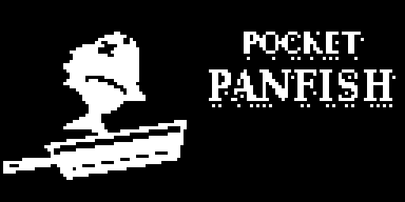
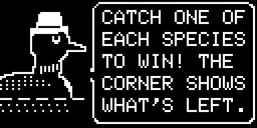
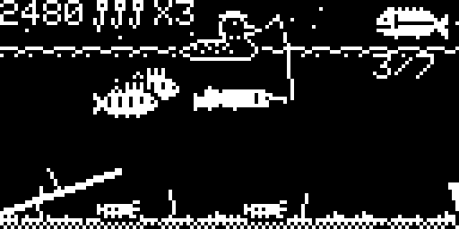
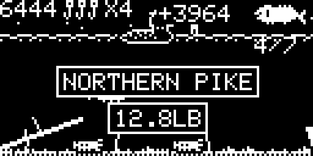
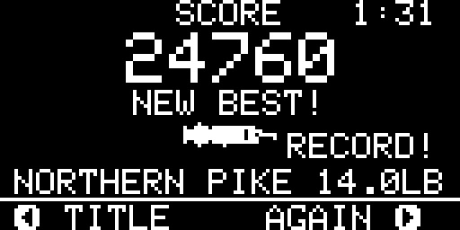

# Pocket Panfish

It's derby night on Lake Huron. Loony Larry, a loon in a fishing hat who lifts lunkers
for a living, needs **one of each of the 7 kinds of fish** in the lake to win the big derby.
Row along the lake, drop your line, and hook each fish by the head, while dodging sunken
logs, snapping turtles and line-cutting gar.

By **jaychugstein** · MIT License · Arduboy FX / FX-C (uses the FX flash chip).

**Play it in your browser:** https://jaychugstein.github.io/Pocket-Panfish/ (works on phones too)

 
 
 

## Controls

| Button | What it does |
|---|---|
| Left / Right | Row along the lake |
| A or B (hold) | Let your line down. It stays down while you hold |
| Let go | Reel in |
| A or B (again, while reeling) | Drop it back down, to bob the lure |
| Up / Down | Sound on or off (sound screen) |
| A or B | Next screen · finish Larry's sentence |
| Right / Left | Fish again / back to the title (score screen) |

A and B do the same thing.

## How to fish

- A fish only bites if your lure touches its **head**. You can hook one on the way down
  or while you reel in.
- Hooked fish come up hanging by the mouth. Bigger ones reel in slower and tug Larry around.
- The **top corner** shows a species you still need, cycling through all the ones left.
- Land a species you already have and it costs you 100 points, your streak and a line.

### The fish

| Fish | Where | What gets it to bite |
|---|---|---|
| Pumpkinseed | Shallow | A lure sinking or rising slowly; dragging it sideways spooks them |
| Perch | Shallow, in small schools | Same as pumpkinseed |
| Largemouth bass | Mid water | A lure being dragged |
| Walleye | Deep | A lure going slowly up or down |
| Lake trout | Near the bottom | A lure left still nearby; fast and skittish |
| Catfish | On the bottom | A lure resting on the bottom |
| Northern pike | Hiding in the weeds | A lure dragged past; it lunges from a long way off |

### Watch out for

- **Sunken logs:** touch one and your line snags and snaps.
- **Snapping turtles:** they come for a lure left on the bottom and bite through the line.
- **Longnose gar:** shows up once you've landed 3 species. It steals fish you're reeling in,
  and if it takes your lure, its teeth cut right through your line.
- **Pike and bass:** they'll grab a little pumpkinseed or perch you're reeling in.
- **Old boots:** -100 points.

You start with 3 lines (up to 5). Spools of line sink down now and then: hook one for a
line back. Lose all your line and the derby's over. Crawfish are worth 50 points, and a
treasure chest is worth 2,000.

## Scoring

- Each new species: its points (bigger fish are worth more), times your streak (up to x5),
  plus a bonus that grows with each one in a row.
- Win the derby: +500 for every line you have left, plus a speed bonus if you finish in
  under 5 minutes.
- Every catch shows its weight. The score screen shows your time, the weight of each fish,
  and your best score. Your **best score** and the **heaviest fish of each species** you've
  ever landed are saved on the FX chip. Beat one and it says RECORD!

## Installing

The ready-made files are in [`release/`](release/):

- `PocketPanfish.arduboy`: the package for the Arduboy FX cart builders and tools
  (includes the game, its FX data, its 4 KB save block and the cart image).
- `PocketPanfish.hex`, `PocketPanfish-fxdata.bin`, `PocketPanfish-fxsave.bin`, `title.png`:
  the same files on their own.

## Building it yourself

- **Arduino IDE:** open `PocketPanfish/PocketPanfish.ino` with the Arduboy2, ArduboyTones
  and ArduboyFX libraries installed, and upload. Then write
  `PocketPanfish/fxdata/fxdata.bin` to the FX chip (for example with the Arduboy FX
  upload tools) for development.
- **Command line:** `build.sh` builds `build/PocketPanfish.hex` with avr-gcc
  (set the library paths at the top).
- **Art:** the pictures are drawn by the Python scripts in `art/`. Run `art.py`,
  `gord.py` and `gordtitle.py`, then `fxpack.py`, which writes `fxdata.h` and the FX data.

The web player in `docs/` uses [Ardens](https://github.com/tiberiusbrown/arduboy_emulator)
by tiberiusbrown (see `docs/ARDENS_LICENSE.txt`).
